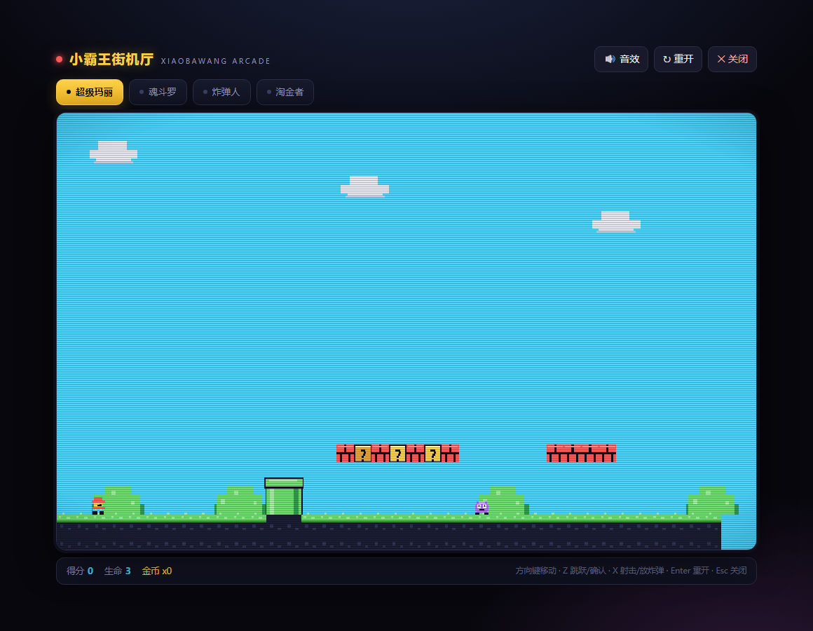
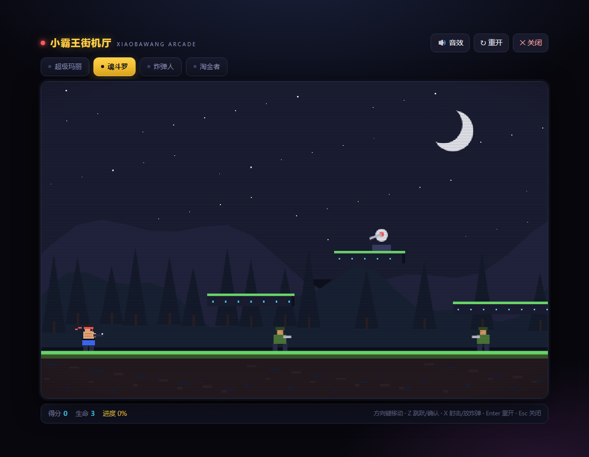
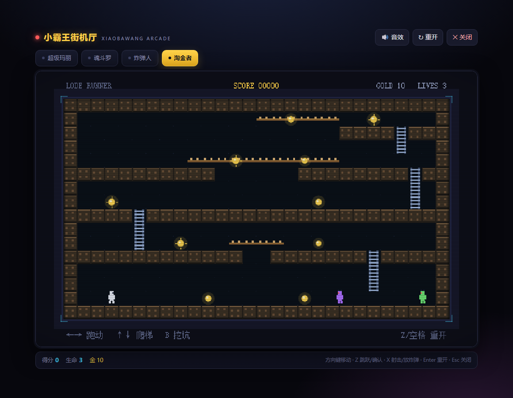

# 小霸王街机厅 · Retro Arcade

四款 FC 经典，一个 DSH 插件：右下角「街机厅」按钮点开就是一台 CRT 机柜。

Four FC classics in one DeepSeek Harness plugin — Super Mario, Contra, Bomberman and Lode Runner share a single 640×400 canvas behind a 街机厅 button at the bottom right.



| 游戏 | 玩法要点 |
|---|---|
| 超级玛丽 | 横版卷轴平台：踩敌人、顶砖块、吃蘑菇变大、举旗过关，3 条命 |
| 魂斗罗 | 横版跑射：八方向射击、士兵与炮台、一枪毙命、结尾 BOSS 带血条 |
| 炸弹人 | 网格放炸弹：十字火柱、连锁引爆、砖块掉道具、清空敌人后走出口 |
| 淘金者 | 经典爬梯：收金块、挖坑困守卫、收齐后出口显形，守卫会追人 |

| 魂斗罗 | 淘金者 |
|---|---|
|  |  |

## 操作

- 方向键 / WASD：移动（魂斗罗里方向键同时决定射击方向）
- `Z` / 空格：跳跃、确认
- `X` / `K`：射击（魂斗罗）、放炸弹（炸弹人）、挖坑（淘金者）
- `Enter`：重开当前游戏
- `Esc`：关闭街机厅
- 右上角可切换音效、重开、关闭

## 安装与卸载

- 安装：插件市场 / **插件** > **添加插件**，选择本目录（`install_bundle`）
- 卸载：**插件** 里关闭或移除 `dsh-arcade`
- 配置：无需任何配置；音效开关记在浏览器 `localStorage.dsh-arcade-muted`

## 结构

```
lib/index.js        Host 半侧：注册 /dsh-arcade 静态路由
lib/client.js       Client 半侧：右下角按钮 + 全屏 iframe
public/index.html   机柜页面（顶栏、标签页、CRT 画布、HUD）
public/arcade.js    外壳：输入、主循环、音效、HUD、错误兜底
public/games/*.js   四个游戏模块（纯 Canvas 2D，无依赖）
```

游戏模块遵循 `GAME-CONTRACT.md` 的 `create(host)` 契约，外壳统一驱动 `reset/update/draw`，因此新增游戏只需往 `public/games/` 放一个文件并在 `index.html` 里加一行 `<script>`。

## 限制

- 四款都是**致敬式复刻**，不是原版 ROM 或反汇编移植，关卡与数值为重新设计。
- 仅键盘操作，暂无触屏手柄。
- 逻辑分辨率固定 640×400，按窗口等比缩放。

## 开发

- 深链：`/dsh-arcade/index.html?game=contra`（可选 `mario` / `contra` / `bomberman` / `loderunner`）
- 冒烟测试：`node tools/smoke.mjs`（VM + 桩 Canvas 跑 880 帧，验证四个模块无异常）
- 外壳与游戏的约定见 `GAME-CONTRACT.md`；新增一款游戏 = `public/games/xxx.js` + `index.html` 一行 `<script>`

## 许可

MIT。游戏玩法致敬任天堂《超级马力欧兄弟》、科乐美《魂斗罗》、Hudson《炸弹人》、Broderbund《淘金者》；本项目不包含任何原版素材、ROM 或反汇编代码。
